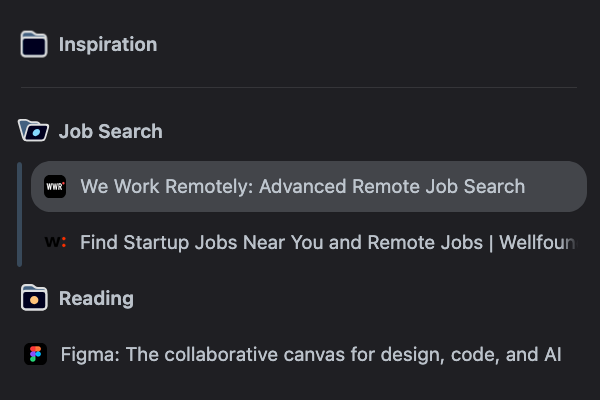

# Unpinned Folders

A [Zen Browser](https://zen-browser.app) mod that lets you use tab groups in the normal (unpinned) tabs section, styled to look exactly like Zen's own folders. Zen folders for pinned tabs keep working as before.

## Install

Zen's official Mods store isn't accepting new mods right now, so this mod installs through Zen's built-in custom styles file (`userChrome.css`). It takes about two minutes.

1. **Turn on two settings.** In Zen, type `about:config` in the address bar and press Return (click **Accept the Risk and Continue** if asked). Search for each setting below and click its toggle (⇄) so it says **true**:
   - `toolkit.legacyUserProfileCustomizations.stylesheets` (lets Zen load custom styles)
   - `browser.tabs.groups.enabled` (turns on tab groups)
2. **Open your profile folder.** Type `about:support` in the address bar. In the table near the top, find **Profile Folder** and click **Open Folder** (macOS: **Show in Finder**).
3. **Open or create the `chrome` folder.** Inside the profile folder, open the folder named `chrome`. If there isn't one, create a new folder with exactly that name.
4. **Add the mod's styles.**
   - If `chrome` has **no** file named `userChrome.css`: open [chrome.css](https://raw.githubusercontent.com/EddyG117/UnpinnedFolders/main/chrome.css), press ⌘S (Ctrl+S on Windows/Linux), and save it into the `chrome` folder as `userChrome.css`. Make sure the name is exactly that, without an extra `.txt` at the end.
   - If `userChrome.css` **already exists**: open it in a text editor, then copy everything from [chrome.css](https://raw.githubusercontent.com/EddyG117/UnpinnedFolders/main/chrome.css) and paste it at the end.
5. **Quit Zen completely** (⌘Q on macOS) and reopen it.
6. **Make a group:** right-click a normal tab and choose **Add Tab to New Group**.

### Updating

Repeat step 4 with the latest [chrome.css](https://raw.githubusercontent.com/EddyG117/UnpinnedFolders/main/chrome.css), replacing the old copy, then restart Zen.

### Uninstalling

Delete `userChrome.css` from the `chrome` folder (or remove the pasted part), set `browser.tabs.groups.enabled` back to **false**, and restart Zen.

## Using groups

- Click a group's name to collapse or expand it.
- When a group is collapsed while you're on one of its tabs, that tab stays visible and the folder shows three dots.
- The dot on the folder icon and the bar beside a group's tabs show the color you picked for the group.

## Known issues

These come from how Zen handles Firefox's tab groups, and a styling mod can't fix them:

- Right-clicking a group's name doesn't open a group menu, so a group can't be renamed, recolored, ungrouped or deleted after it's created. To take tabs out, right-click a tab and choose **Remove from Group**. A group disappears when its last tab leaves.
- After restarting Zen, collapsed groups reopen expanded.
- After restarting Zen, and when you split two tabs that are already in a group, split views end up outside the group.
- Dropping a tab onto a group's name doesn't add it. Drop it between the group's tabs instead.
- Dragging a whole group into the pinned section pins its tabs one by one instead of moving the group.
- Zen's **Clear** button closes expanded groups (undo brings them back) but skips collapsed ones.
- Groups are named in Firefox's pop-up panel instead of inline in the sidebar, and can't have a custom folder icon.
